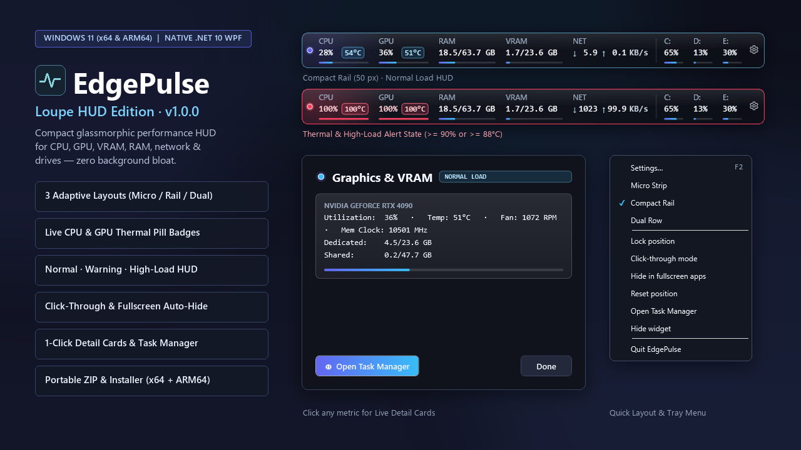
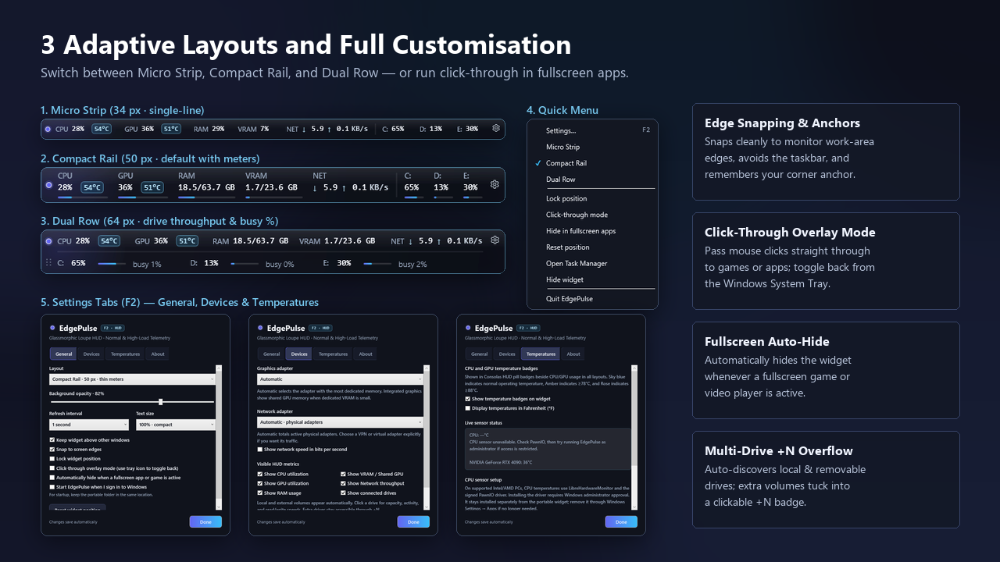
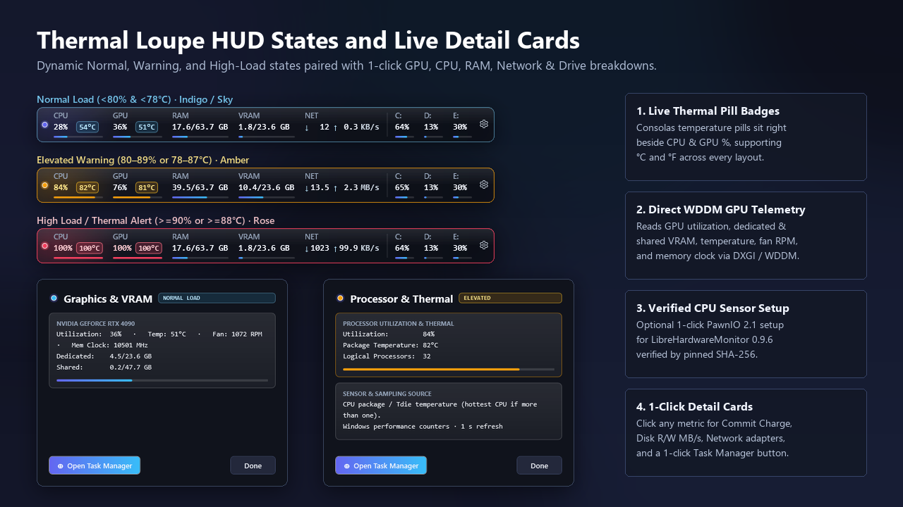

# EdgePulse — Windows 11 Performance & Thermal HUD (v1.0.0)

> **A compact, zero-bloat glassmorphic floating performance HUD for Windows 11 (x64 & ARM64).**  
> Self-contained native `.NET 10` WPF app | 3 adaptive layouts (`Micro Strip`, `Compact Rail`, `Dual Row`) | Live CPU & GPU thermal pill badges (`°C` / `°F`) | 1-click live Detail Cards | Click-through & fullscreen auto-hide.



---

## Key Features

### 1. Three Adaptive Layouts (`34 px`, `50 px`, `64 px`)


* **Micro Strip (`34 px` tall):** Ultra-slim single-line bar ideal for sitting along the top or bottom edge of your screen. Displays `CPU`, `GPU`, `RAM %`, `VRAM %`, `NET`, and drive usage inline.
* **Compact Rail (`50 px` tall — Default):** Clean two-tier layout with metric labels above crisp monospaced values (`18.5/63.7 GB` RAM/VRAM) and thin Indigo-to-Sky gradient load meters underneath.
* **Dual Row (`64 px` tall):** Dedicated second row for all connected drives showing capacity %, individual meter bars, and live disk activity (`busy %`).
* **Multi-Drive `+N` Overflow:** Local and removable drives appear automatically; when more volumes are connected than fit on screen, extra drives tuck into a clickable **`+N`** badge.

### 2. Thermal Loupe HUD & Dynamic Load States


EdgePulse shifts its ambient glow, double-ring status dot, meter bars, border accent, and Consolas temperature pills automatically based on utilization and thermal thresholds:
* **Normal Load (`< 80%` utilization and `< 78°C`):** Indigo/Sky double-ring indicator (`#6366F1`), sky-blue temperature pill badges, and Indigo-to-Sky gradient meters.
* **Elevated Warning (`80–89%` utilization or `78–87°C`):** Amber status dot, amber temperature pills, and amber border/meter highlights.
* **High Load / Thermal Alert (`>= 90%` utilization or `>= 88°C`):** Rose-coral alert indicator, rose-coral temperature pills, and rose-coral border/meter highlights.

### 3. Live Glassmorphic Detail Cards & 1-Click Task Manager
* Click **CPU**, **GPU**, **RAM**, **VRAM**, **NET**, or any **Drive** cell directly on the widget to open a live `470 × 415` detail window:
  * **Processor & Thermal:** CPU utilization %, package/Tdie temperature, logical processor count, and sensor status.
  * **Graphics & VRAM:** Per-adapter GPU utilization %, WDDM temperature, Fan RPM, Memory Clock (MHz), Dedicated VRAM, and Shared GPU memory.
  * **Memory & Commit:** Both Physical RAM and Commit Charge (`RAM + Pagefile`).
  * **Network Adapters:** Live Receive (`↓`) and Send (`↑`) throughput across physical and virtual/VPN adapters.
  * **Drives:** Used/Free capacity, disk activity %, and live Read/Write throughput (`MB/s`).
* Every detail window includes a **1-click `Open Task Manager`** button.

### 4. Direct Windows Telemetry & Verified CPU Sensor Setup
* **100% Local & Private:** Reads directly from Windows Performance Counters (`PDH`), `DXGI`, `WDDM` (`D3DKMTQueryAdapterInfo`), `GlobalMemoryStatusEx`, and `IP Helper`. Requires no accounts, cloud telemetry, or vendor bloatware, and Task Manager does not need to be open.
* **Smart Network Aggregation:** Automatic mode sums active physical interfaces while excluding filter drivers, virtual interfaces, and endpoint devices to avoid double-counting (or pick a VPN/virtual adapter explicitly in Settings).
* **Optional CPU Temperature Setup (x64):** Uses `LibreHardwareMonitorLib 0.9.6` (`MPL-2.0`) and the signed `PawnIO 2.1.0` driver on supported Intel/AMD x64 PCs. Clicking **Settings → Temperatures → Set up CPU sensor driver…** downloads the official signed installer verified against a pinned SHA-256 hash (`A3A46226C5E2824F4CDD42BE0EECBABFC672C86F7889710F5AB1E6AD385B47A0`) and prompts for standard Windows UAC approval. Missing sensors display a clean dash (`—°C` / `—°F`) rather than fabricated values. *(Note: CPU temperature is currently unavailable on ARM64 devices.)*

### 5. Full Customisation, Edge Snapping & Overlay Modes
* **Edge Snapping & Anchor Memory:** Drag the left status indicator dot (or **`Alt + Drag`** anywhere on the widget) to move. Automatically snaps near monitor work-area edges, avoids the Windows taskbar, and remembers your corner anchor per monitor.
* **Click-Through Overlay Mode:** Pass mouse clicks straight through the widget to fullscreen apps or games; toggle it back anytime from the Windows System Tray icon.
* **Fullscreen Auto-Hide:** Automatically hides the widget whenever a fullscreen game or video player is in the foreground, and restores it when you exit.
* **Fine-Tuned Appearance (`F2` Settings):** Adjust background opacity (`45%–100%`), refresh interval (`1s / 2s / 5s`), text scaling (`100% / 110% / 125% / 150%`), Always-on-Top, Position Lock, `°C / °F`, `bps / B/s`, and individual metric visibility toggles.

---

## Installation and Package Contents

> **Download the latest installers and portable packages from [GitHub Releases (`v1.0.0`)](https://github.com/Gregrioum/EdgePulse/releases/latest)** — or get EdgePulse on **[Gumroad](https://gregrioum.gumroad.com/l/edgepulse-windows-hud)**.

EdgePulse ships as self-contained single-file packages for both **Intel/AMD (`win-x64`)** and **Windows on Arm (`win-arm64`)**—no separate `.NET` runtime download required.

| File | Size | Description |
| :--- | :--- | :--- |
| **`EdgePulse-1.0.0-win-x64-Setup.exe`** | `~68.9 MB` | **x64 Setup Wizard (Recommended for Intel/AMD):** Per-user install to `%LocalAppData%\Programs\EdgePulse` (no admin rights required), Start Menu shortcut, optional Desktop shortcut & sign-in startup, and Windows Settings uninstaller. |
| **`EdgePulse-1.0.0-win-x64-Portable.zip`** | `~68.5 MB` | **x64 Portable Archive:** Extract to a writable folder and run `EdgePulse.exe` with `portable.flag` beside it. Stores preferences in `Data\settings.json`. |
| **`EdgePulse-1.0.0-win-arm64-Setup.exe`** | `~63.6 MB` | **ARM64 Setup Wizard:** Native Windows on Arm installer (per-user, no admin required). |
| **`EdgePulse-1.0.0-win-arm64-Portable.zip`** | `~63.2 MB` | **ARM64 Portable Archive:** Native Windows on Arm standalone portable package. |
| **`SHA256SUMS.txt`** | `< 1 KB` | SHA-256 verification checksums for all four release binaries. |

### System Requirements
* **OS:** Windows 11 (`10.0.22000` or newer), `x64` or `ARM64`
* **Dependencies:** **None.** Self-contained `.NET 10` WPF single-file executable.

---

## Quick-Start Usage Guide

### Step 1 — Install or Extract
* **Installer:** Run **`EdgePulse-1.0.0-win-x64-Setup.exe`** (or `win-arm64-Setup.exe` on ARM64 PCs).
* **Portable:** Extract the entire **`EdgePulse-1.0.0-win-x64-Portable.zip`** (or `win-arm64-Portable.zip`) into a writable folder (do not launch directly from inside a ZIP preview) and keep `portable.flag` next to `EdgePulse.exe`.

### Step 2 — Position & Personalize
1. Drag the **left pulsing status dot** (or hold **`Alt` + drag** anywhere on the bar) to snap EdgePulse to any monitor corner or edge.
2. Press **`F2`** (when focused) or click the **gear icon** on the right to switch between **Micro Strip**, **Compact Rail**, and **Dual Row**, adjust opacity (`45%–100%`), or toggle individual metrics.

### Step 3 — Inspect Live Hardware Details
* **Left-click** `CPU`, `GPU`, `RAM`, `VRAM`, `NET`, or any drive letter to open its live glassmorphic **Detail Card**.
* *(Optional, x64)* Go to **Settings → Temperatures → Set up CPU sensor driver…** to enable live CPU package temperatures via the verified PawnIO driver.

---

## Controls and Shortcuts Cheat Sheet

| Context | Action / Shortcut | Result |
| :--- | :--- | :--- |
| **Widget Bar** | `Drag Status Dot` or `Alt + Drag` | Move widget and snap to monitor work-area edges |
| **Widget Bar** | `Left-Click` `CPU` / `GPU` / `RAM` / `VRAM` / `NET` / `Drive` | Open live Detail Card with 1-click Task Manager |
| **Widget Bar** | `Left-Click` `+N` Badge | Open overflow menu listing all connected drives |
| **Widget Bar** | `Left-Click` Gear Icon or `F2` | Open Settings window (`General`, `Devices`, `Temperatures`, `About`) |
| **Widget Bar / Tray** | `Right-Click` | Quick switch layout, Lock position, Click-through mode, Fullscreen auto-hide, Reset position, Hide, Quit |
| **System Tray Icon** | `Double-Click` | Reveal hidden widget and open Settings |

---

## Building from Source & Local Verification

Source code is in `src/EdgePulse` (`.NET 10` WPF + `LibreHardwareMonitorLib 0.9.6`), packaging definition in `packaging/EdgePulse.iss` (Inno Setup), and build automation in `scripts/Build.ps1`:

```powershell
# Build both x64 and arm64 portable ZIPs, installers, and SHA256SUMS.txt
.\scripts\Build.ps1

# Run isolated local diagnostics & render visual verification PNGs
.\EdgePulse.exe --verify .\verify-out
```

---

## License

Released under the **MIT License** (see [LICENSE.txt](./LICENSE.txt)).  
Third-party components (`LibreHardwareMonitorLib 0.9.6` under `MPL-2.0` and bundled `.NET` runtime notices) are documented in [THIRD-PARTY-NOTICES.txt](./THIRD-PARTY-NOTICES.txt).
